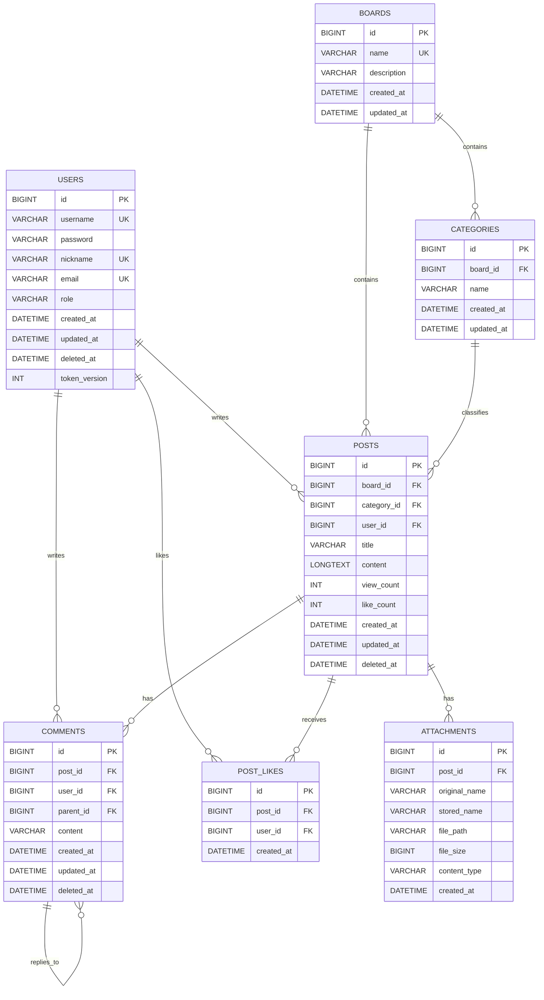

# Board Project ERD

## 관계 요약

- `users 1:N posts`
- `users 1:N comments`
- `users 1:N post_likes`
- `boards 1:N categories`
- `boards 1:N posts`
- `categories 1:N posts`
- `posts 1:N comments`
- `posts 1:N post_likes`
- `posts 1:N attachments`
- `comments 1:N comments` (`parent_id`로 대댓글 표현)

## 회원 토큰 버전

- `users.token_version`은 V8 마이그레이션에서 추가된다.
- 기본값은 `0`이며, JWT에 기록된 버전과 회원 레코드의 현재 버전을 비교해 이전 토큰을 거부하는 데 사용한다.
